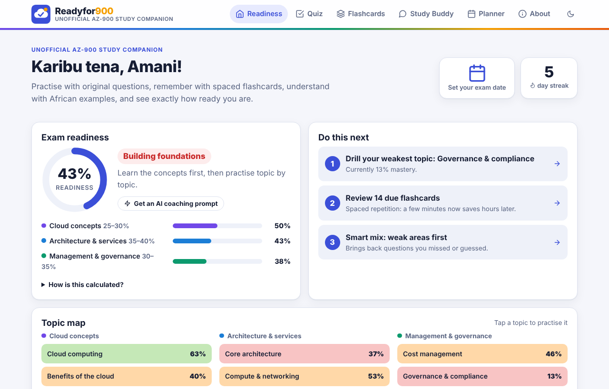
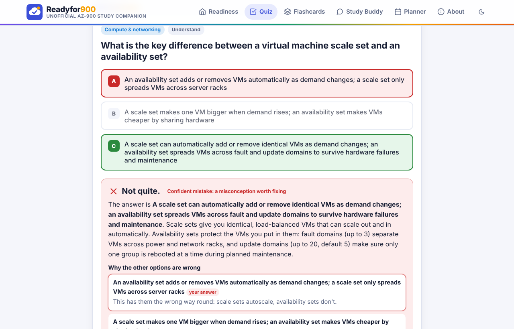
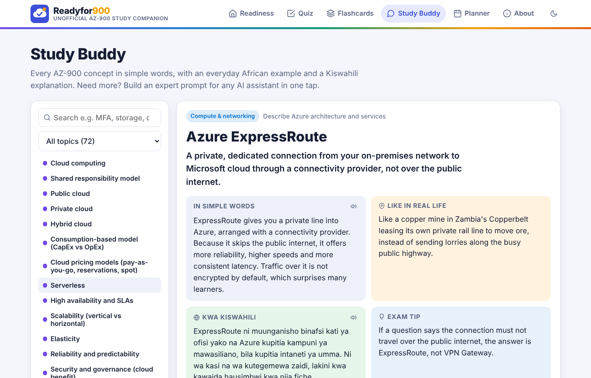
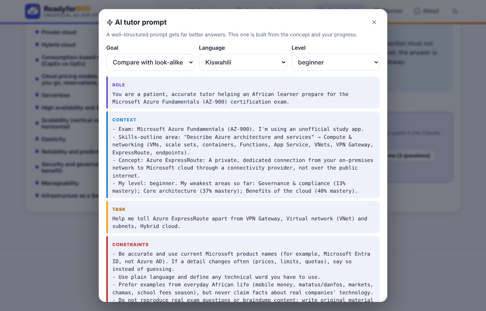
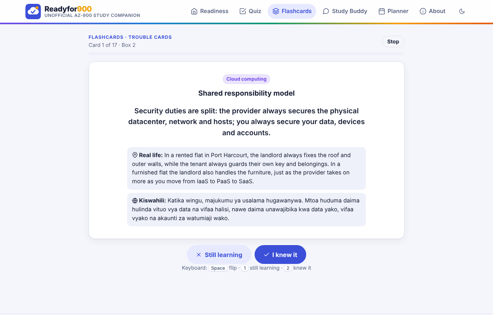
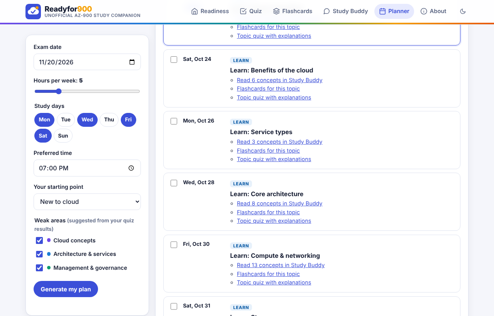
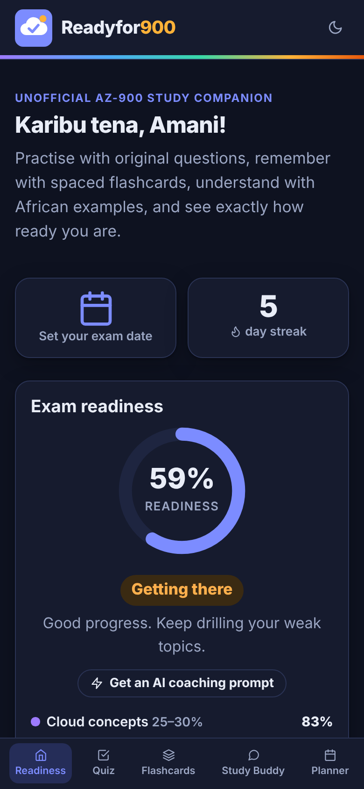

# Readyfor900 ☁️✓ An unofficial AZ-900 study companion

> **Uko redi?** Every AZ-900 learner asks *"am I ready?"*. Readyfor900 helps you get ready, and shows you when you are.
> Practise with original questions, remember with spaced flashcards, understand with African examples, and see exactly how ready you are.

**Live demo:** https://cikukabiru-bit.github.io/readyfor900/ · **Code:** https://github.com/cikukabiru-bit/readyfor900

> ⚠️ **Unofficial.** Readyfor900 is not affiliated with, endorsed by or connected to Microsoft. All questions, flashcards and explanations are **original** practice material based on the public [AZ-900 skills outline](https://learn.microsoft.com/credentials/certifications/resources/study-guides/az-900) (skills measured as of July 20, 2026). They are not real exam questions. No Microsoft logos are used.

Built for the **Power Learn Project #1MillionDevs Vibe Coding Hackathon: AZ-900 Exam Prep Edition**.



---

## The problem
AZ-900 learners commonly hit five walls:
1. They practise questions but **don't understand why** an answer is right or wrong.
2. They **forget** Azure terms that sound alike (LRS/ZRS/GRS, VPN Gateway vs ExpressRoute, RBAC vs Azure Policy…).
3. They **don't know how to plan** study time before an exam date.
4. Cloud concepts feel **abstract**, and most examples come from contexts far from African learners' daily lives.
5. They **can't tell if they're ready** to book the exam.

## The solution: one connected study loop
Readyfor900 tackles **all five hackathon challenges** in one app, and the features feed each other:

| Challenge | Readyfor900 feature | What makes it different |
|---|---|---|
| 📝 Smart Quiz Builder | **Smart Quiz**: 58 original questions across all 11 outline topics | An explanation for **every option**, not just the right one. A **"Sure / Guessing" confidence check** before every answer. Smart mix (weak areas first) and a timed 20-question mock exam weighted by exam domain |
| 🧠 Flashcard Coach | **Flashcards**: 72 key concepts in 5 Leitner boxes | Spaced repetition (1, 3, 7, 14 days). **Wrong or guessed quiz answers automatically send the related flashcards back to Box 1** |
| 📅 Personal Study Planner | **Planner**: exam date + hours + study days + weak areas | Gives more time to heavier exam domains *and* your weak topics, adds drills, a mock exam and a review day, and **exports to your calendar (.ics)** |
| 🤖 AI Study Buddy | **Study Buddy**: every concept in simple words, with an **African real-life example** and **Kiswahili**, plus read-aloud | **Prompt builder** that turns your progress into a structured prompt for Claude, ChatGPT or Copilot, in 14 languages including Kiswahili, Hausa, Yoruba, Amharic, isiZulu and Sheng |
| 📊 Readiness Tracker | **Readiness dashboard**: score weighted like the exam, topic heat map, "do this next" | A **confidence-calibration grid** that separates real knowledge from lucky guesses and confident misconceptions |

| Quiz feedback | Study Buddy | Prompt builder |
|---|---|---|
|  |  |  |

| Flashcards | Planner | Mobile (dark mode) |
|---|---|---|
|  |  |  |

## Who it's for
- **First-time cloud learners** across Africa preparing for AZ-900 (students, career-switchers, bootcamp cohorts like PLP).
- **Busy learners on phones.** It's mobile-first, works offline after loading, needs no account and uses little data.
- **Study groups and trainers**, who can point a cohort at the same free link.

## How it works
- **Readiness score:** for each topic, your accuracy on your last 10 answers (a *lucky guess* counts as half), scaled by how much of the topic you've covered. Topics roll up into the three exam domains, which are weighted like the real outline (25–30%, 35–40%, 30–35%). "Exam ready" = 80%+ overall **and** every domain at 70%+.
- **Smart mix:** ranks questions by topic weakness, past mistakes (confident mistakes first), lucky guesses and unseen questions.
- **Spaced repetition:** Leitner boxes 1–5 with review gaps of 0/1/3/7/14 days. Quiz mistakes are linked to concepts by matching terms and keywords.
- **Planner:** splits the days before your exam into learn sessions (one or more per topic, weighted by exam weight × weakness), weak-area drills, a mock exam and a light review day.
- **AI prompts:** see **[PROMPTS.md](PROMPTS.md)** for the full prompt-engineering write-up.

## Prompt engineering
Prompts were central to **building** the app (structured, fact-checked content prompts in [`/prompts`](prompts/)) and are a core **feature** of it (Role → Context → Task → Constraints → Output format, filled with the learner's own data). Full details and examples: **[PROMPTS.md](PROMPTS.md)**.

## Tech
- **Plain HTML, CSS and JavaScript.** No framework, no build step, no backend, no API keys.
- Hash-based routing; progress saved in `localStorage` (private to the learner's browser).
- Accessible: keyboard shortcuts in quiz and flashcards, focus styles, `prefers-reduced-motion`, light/dark themes, read-aloud with the Web Speech API.
- Built with AI pair programming (Claude), then reviewed and tested.

```
index.html            app shell + navigation
css/styles.css        design tokens, light/dark themes, responsive layout
js/data/topics.js     exam domains + topics (from the public skills outline)
js/data/questions-*.js  original questions, one file per domain
js/data/concepts.js   flashcards / Study Buddy concepts (EN + Kiswahili)
js/engine.js          pure logic: readiness, smart mix, Leitner, planner, .ics, prompt builder
js/store.js           localStorage persistence + sample data
js/app.js             views and interactions
tools/                content validator + engine tests
prompts/              the prompts used to create the content
```

## Run it locally
Just open `index.html` in a browser, or use VS Code **Live Server**.

Quality checks (needs Node.js):
```bash
node tools/validate-content.js   # schema + rules for every question and concept
node tools/test-engine.js        # unit tests for readiness, Leitner, planner, prompts
```

## Deploy to GitHub Pages
1. Push this folder to a public GitHub repo named `readyfor900`.
2. Open **Settings → Pages**, set **Source: Deploy from a branch**, then choose **Branch: `main` / root** and save.
3. After about a minute your app is live at `https://<username>.github.io/readyfor900/`.

## Impact and scalability
- **Other certifications:** the exam structure (`topics.js`) and content files are plain data. Adding AI-900, DP-900, SC-900 or AZ-104 means adding new data files, not new code.
- **More languages:** concepts already carry Kiswahili. The same field pattern can add Hausa, Amharic, French and others, written by community volunteers.
- **Community content:** the validator makes it safe to accept question pull requests from learners.
- **Next steps:** optional cloud sync (e.g. Supabase) for cohort leaderboards, trainer dashboards, offline PWA install, and more questions per topic.

## Content accuracy
- Every question maps to a topic in the current public skills outline (July 20, 2026).
- Questions are original. Distractors are real, commonly confused Azure services, and each one is explained.
- Spotted an error? Please open an issue. Accuracy matters more than anything else here.

## License
MIT. Free to use, adapt and share for learning.
